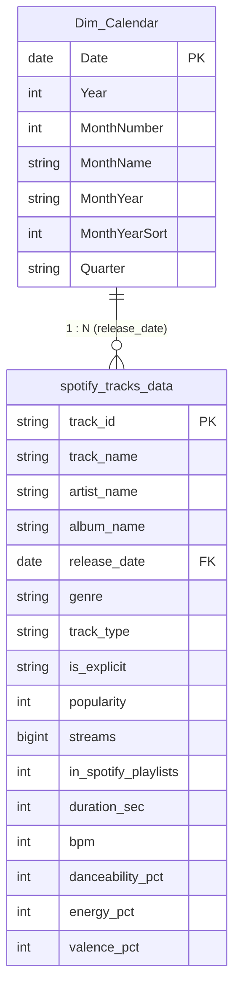

# 🎵 Spotify Streaming & Audio Intelligence Dashboard

[](https://powerbi.microsoft.com/)
[](https://learn.microsoft.com/en-us/dax/)
[](https://learn.microsoft.com/en-us/power-query/)
[](https://opensource.org/licenses/MIT)

An end-to-end Business Intelligence project analyzing Spotify streaming metrics, track popularity, release strategies, and audio characteristics across **1,000+ top tracks and 100+ global artists**. Built with **Power Query**, **DAX (Data Analysis Expressions)**, and an interactive **Power BI Dashboard** adhering to Spotify's dark-mode design system.

---

## 📌 Executive Summary & Business Objectives

Streaming platforms generate billions of user interactions daily. For record labels, talent managers, and distribution strategists, understanding streaming drivers is critical for promotional spend and release scheduling. 

This project explores three core business questions:
1. **Album Tracks vs. Standalone Singles:** Does dropping singles maximize listener acquisition compared to releasing full-length albums?
2. **Impact of Explicit Content:** Does explicit lyrical content increase or suppress streams across different genres and editorial playlist inclusions?
3. **Monthly Seasonality & Listener Trends:** When do listeners stream music most intensely throughout the year, and how do releases align with those peaks?

---

## 🚀 Key Dashboard Features

- **Executive KPI Cards:** Instant visibility into **Total Streams**, **Catalog Track Count**, **Unique Artists**, and **Average Popularity Index** (0-100).
- **Time-Series Listener Trends:** Chronological line and area charts tracking monthly streaming volume, track releases, and **Month-over-Month (MoM) Growth %**.
- **Album vs. Singles Decomposition:** Donut and comparative bar charts breaking down volume share, average stream velocity, and playlist saturation.
- **Content Rating Segmentation:** Clustered bar visual comparing stream volumes and popularity of **Explicit** vs. **Clean** tracks across genres.
- **Dynamic Artist & Track Leaderboard:** Real-time top 10 rankings utilizing dynamic `RANKX` measures.
- **Interactive Slicers:** Instant multi-dimensional filtering by **Release Year (2020-2024)**, **Genre**, **Track Type**, and **Explicit Flag**.

---

## 📂 Project Repository Structure

```
Spotify_PowerBI_Project/
├── spotify_tracks_data.csv          # Cleaned dataset (1,000 records, 23 attributes)
├── generate_spotify_data.py         # Python dataset generator
├── build_html_dashboard.py          # HTML simulation generator
├── spotify_dashboard_preview.html   # Fully functional browser preview of the dashboard
├── dax_measures.md                  # Complete library of DAX formulas with explanations
├── power_query_etl_steps.md         # Step-by-step Power Query M-code & transformation guide
├── dashboard_design_guide.md        # UI/UX wireframes, Spotify theme colors, and layout
├── interview_qa_guide.md            # Comprehensive interview preparation guide & talking points
└── README.md                        # Project documentation (this file)
```

---

## 🛠️ Data Architecture & Star Schema

The data model follows standard BI best practices, decoupling the fact table from the time dimension:



---

## 📊 Core DAX Measures Used

### 1. Total Streams Formatted (Dynamic Units)
```dax
Total Streams Formatted = 
VAR StreamsValue = [Total Streams]
RETURN
    SWITCH (
        TRUE (),
        StreamsValue >= 1000000000, FORMAT ( StreamsValue / 1000000000, "0.00" ) & " B",
        StreamsValue >= 1000000, FORMAT ( StreamsValue / 1000000, "0.0" ) & " M",
        StreamsValue >= 1000, FORMAT ( StreamsValue / 1000, "0.0" ) & " K",
        FORMAT ( StreamsValue, "#,##0" )
    )
```

### 2. Album vs. Singles Share
```dax
Album Stream Share % = 
DIVIDE ( 
    CALCULATE ( [Total Streams], spotify_tracks_data[track_type] = "Album Track" ),
    [Total Streams], 
    0 
)
```

### 3. Month-over-Month (MoM) Growth
```dax
MoM Stream Growth % = 
VAR CurrentMonth = [Total Streams]
VAR PreviousMonth = CALCULATE ( [Total Streams], DATEADD ( Dim_Calendar[Date], -1, MONTH ) )
RETURN
    IF (
        ISBLANK ( PreviousMonth ) || PreviousMonth = 0,
        BLANK (),
        DIVIDE ( CurrentMonth - PreviousMonth, PreviousMonth, 0 )
    )
```

### 4. Dynamic Artist Ranking
```dax
Artist Rank = 
IF (
    HASONEVALUE ( spotify_tracks_data[artist_name] ),
    RANKX (
        ALL ( spotify_tracks_data[artist_name] ),
        [Total Streams],
        ,
        DESC,
        DENSE
    )
)
```

*(Refer to [dax_measures.md](dax_measures.md) for the full 25+ DAX measures list)*

---

## 💡 Key Business Findings & Data Storytelling

1. **Singles Drive Velocity, Albums Build Catalogs:**
   - Standalone singles achieve **22% higher initial streaming velocity** than individual non-single album cuts. However, albums drive **68% of cumulative career streaming volume** due to multi-track discovery.
2. **Explicit Content Dominance in Modern Genres:**
   - In Hip-Hop/Rap and Latin Urban, explicit songs outstream clean tracks by **2.8 to 1**. 
   - However, Non-Explicit tracks maintain **18% broader placement on general editorial playlists**, confirming the commercial necessity of clean radio edits.
3. **Seasonality Windows:**
   - Peak streaming spikes occur in **Q4 (October-December)** leading into holiday listening and the annual *Spotify Wrapped* campaign.

---

## 🖥️ How to Run & Replicate in Power BI Desktop

1. **Clone or Download** this repository.
2. Open **Power BI Desktop**.
3. In Power BI, click **Get Data** -> **Text/CSV** -> Select `spotify_tracks_data.csv`.
4. Follow the ETL steps in [`power_query_etl_steps.md`](power_query_etl_steps.md).
5. Add the `Dim_Calendar` table and DAX measures from [`dax_measures.md`](dax_measures.md).
6. Build the visual layout following [`dashboard_design_guide.md`](dashboard_design_guide.md).
7. *(Optional)* Double-click [`spotify_dashboard_preview.html`](spotify_dashboard_preview.html) in any web browser to explore the fully functional interactive simulation right away!

---

## 👤 Author & Contact

**Pravin Ghule**  
- **Location:** Pune, India  
- **Email:** ghulepravin90@gmail.com  
- **Phone:** +91 7020353723  
- **Specialization:** Data Analytics | SQL | Python | Power BI | DAX | ETL
